# 🪺 Unser Nest

*[🇬🇧 English version available here](README.en.md)*

Eine kleine [Firebase](https://firebase.google.com)-Webanwendung für werdende
Eltern: eine gemeinsame Checkliste für die Zeit vor und nach der Geburt, ein
gemeinsames Notizbuch, ein Inventar für die Baby-Kleidung, eine gemeinsame
Namensliste und ein Wehen-Timer. Die App synchronisiert in Echtzeit zwischen euren Geräten,
funktioniert auch offline und lässt sich wie eine App auf dem Handy
installieren. Als Datenbank kommt [Cloud Firestore](https://firebase.google.com/docs/firestore)
zum Einsatz, die Anmeldung läuft über Google-Konten.

<p align="center">
  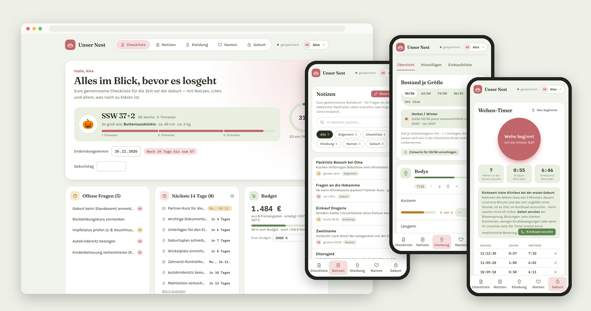
  <br><sub>Mit erfundenen Beispieldaten – mehr Bilder unter <a href="#so-sieht-die-app-aus">So sieht die App aus</a></sub>
</p>

Diese Dokumentation beschreibt den kompletten Setup-Prozess von null auf eine
lauffähige, selbst gehostete Instanz – inklusive Zugriffsregeln, lokaler
Entwicklung und Deployment.

> **Hinweis:** Diese Dokumentation und der zugehörige Code enthalten keine
> personenbezogenen Daten (keine echten Namen, E-Mail-Adressen, Projekt-IDs
> oder Zugangsdaten). Alle Beispielwerte sind frei erfunden bzw. exemplarisch.

---

## Inhaltsverzeichnis

1. [Funktionsübersicht](#funktionsübersicht)
2. [So sieht die App aus](#so-sieht-die-app-aus)
3. [Technischer Stack](#technischer-stack)
4. [Projektstruktur](#projektstruktur)
5. [Voraussetzungen](#voraussetzungen)
6. [Setup Schritt 1: Firebase-Projekt einrichten](#setup-schritt-1-firebase-projekt-einrichten)
7. [Setup Schritt 2: Zugriffsregeln anlegen](#setup-schritt-2-zugriffsregeln-anlegen)
8. [Setup Schritt 3: Lokale Entwicklungsumgebung](#setup-schritt-3-lokale-entwicklungsumgebung)
9. [Setup Schritt 4: Deployment auf Firebase Hosting](#setup-schritt-4-deployment-auf-firebase-hosting)
10. [Konfiguration](#konfiguration)
11. [Tests](#tests)
12. [Datenbank-Schema-Referenz](#datenbank-schema-referenz)
13. [Troubleshooting](#troubleshooting)
14. [Sicherheitshinweise](#sicherheitshinweise)
15. [Lizenz](#lizenz)

---

## Funktionsübersicht

| Bereich | Funktionen |
|---|---|
| ✅ **Checkliste** | 10 Kategorien mit 74 recherchierten Beispielpunkten; pro Punkt Frist, Termin (optional wöchentlich), Preis, Zuständigkeit (ich / Partner:in / beide), Notizen, offene Fragen und Links; „erledigt von … am …“; Punkte und Kategorien mit dem **Griff ⠿** verschieben (ziehen oder antippen – Menü mit ganz nach oben/unten, eins nach oben/unten, in andere Kategorie), umbenennen und löschen (mit „Rückgängig“); Suche und Filter; **Vorlagen-Pakete** zum Nachladen (ausführliche Kliniktasche, Behörden nach der Geburt, Wochenbett, Geburtsplan); Drucken |
| 📝 **Notizen** | Gemeinsames **Notizbuch** als eigener Bereich: Notizen mit Titel und Text, je einem Bereich zugeordnet (Allgemein, Checkliste, Kleidung, Namen, Geburt); Suche und Filter, **angeheftete** Notizen oben; „zuletzt geändert von … “; gespeichert wird beim Tippen |
| 🤰 **Schwangerschaft** | Aktuelle Schwangerschaftswoche aus dem Entbindungstermin (z. B. „SSW 32+0“), Trimester-Leiste, Größenvergleich mit Obst/Gemüse; nach der Geburt das Alter des Babys |
| 📊 **Übersicht** | Kacheln für offene Fragen, Termine & Fristen und Budget (Summe aller Preise, erledigt/offen, eigenes Budget-Ziel); Kalender-Export als `.ics` mit Erinnerung am Vortag |
| 👕 **Baby-Kleidung** | Kleidungsstücke mit Kategorie, Größe (50/56 bis 86/92, Uni Size), Farbe, Muster, Menge, Foto, Herkunft (gekauft/geschenkt/geliehen/gebraucht), „von wem“ und „gewaschen“; Bestand je Größe mit eigenen Zielen; **Jahreszeit je Größe** anhand des Entbindungstermins; Zielwert-Vorschlag passend zur Jahreszeit; **Einkaufsliste** „Was noch fehlt“; Suche, Filter und Foto-Großansicht |
| 💕 **Namen** | Gemeinsame Namensliste (Mädchen/Junge/neutral, Bedeutung); jede Person bewertet für sich; die Bewertung der anderen Person wird erst nach der eigenen sichtbar; **Treffer**, wenn beide einen Namen mögen; Nachname zum Probelesen |
| ⏱️ **Geburt** | **Wehen-Timer** live auf beiden Geräten mit Auswertung der letzten Stunde; wichtige Telefonnummern mit Anruf-Knopf; Stand der Kliniktasche aus der Checkliste |
| 🔄 **Zusammenarbeit** | Echtzeit-Sync; gleichzeitige Änderungen werden **zusammengeführt** statt überschrieben; **eigene Anzeigenamen** (z. B. Spitznamen) unabhängig vom Google-Profil |
| 📴 **Offline & App** | Offline-Speicher für Daten und App; installierbar als App (Android, iPhone, Desktop) |
| 🕰️ **Verlauf** | Wer hat wann was geändert (die letzten 90 Tage), Filter nach Person und Bereich, **Rückgängig** bzw. **Wiederherstellen** je Eintrag; **Rückfrage vor jedem Löschen** |
| 💾 **Sicherung** | Export als ZIP (CSV-Dateien inkl. Notizen und Verlauf, Fotos, vollständiges JSON) und Wiederherstellen daraus |
| 🔒 **Zugriffsschutz** | Anmeldung nur mit Google und nur für freigegebene, verifizierte Adressen – serverseitig geprüft |

---

## So sieht die App aus

> Alle Inhalte auf den Bildern sind **erfundene Beispieldaten**: zwei
> Demo-Personen „Alex“ und „Sam“, ein ausgedachter Entbindungstermin, das
> „Klinikum Musterstadt“ und Telefonnummern ohne Funktion. Die Bilder stammen
> aus der lokalen Testumgebung (Firebase Emulator), nicht aus einer echten
> Installation.

### Checkliste

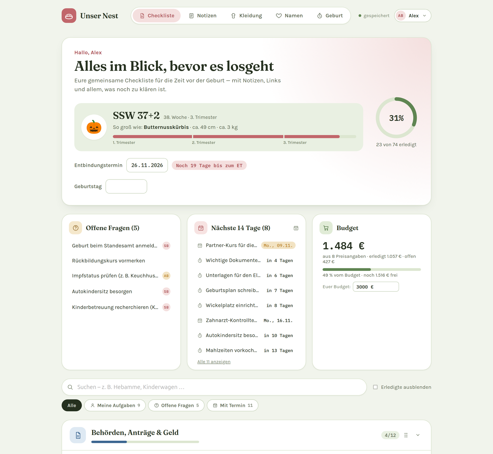

Oben Schwangerschaftswoche mit Größenvergleich und der Fortschritt der
Checkliste, darunter offene Fragen, Termine und Fristen der nächsten 14 Tage
und das Budget.

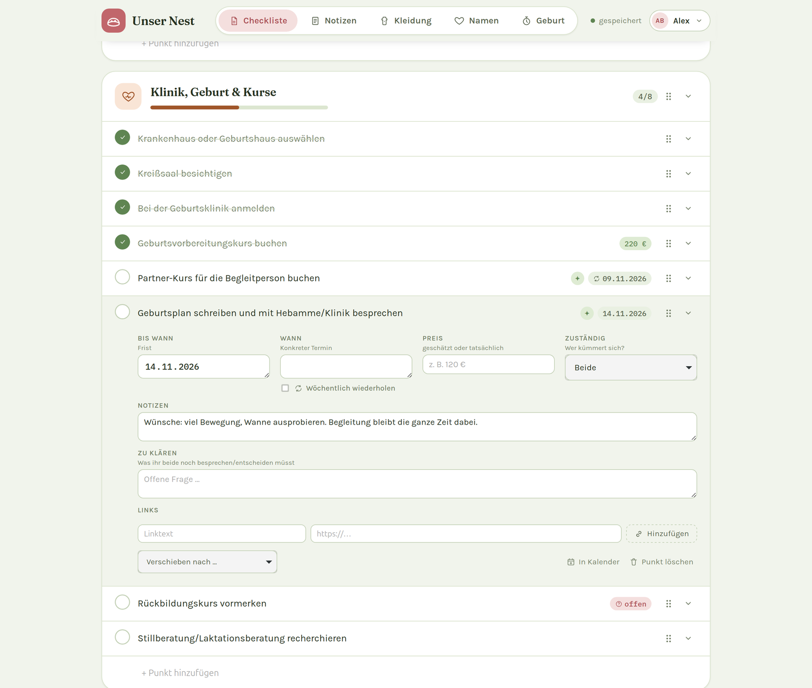

Ein aufgeklappter Punkt: Frist, Termin (optional wöchentlich), Preis,
Zuständigkeit, Notizen, offene Fragen und Links. „Erledigt von … am …“
erscheint nach dem Abhaken.

<table>
  <tr>
    <td align="center" width="33%">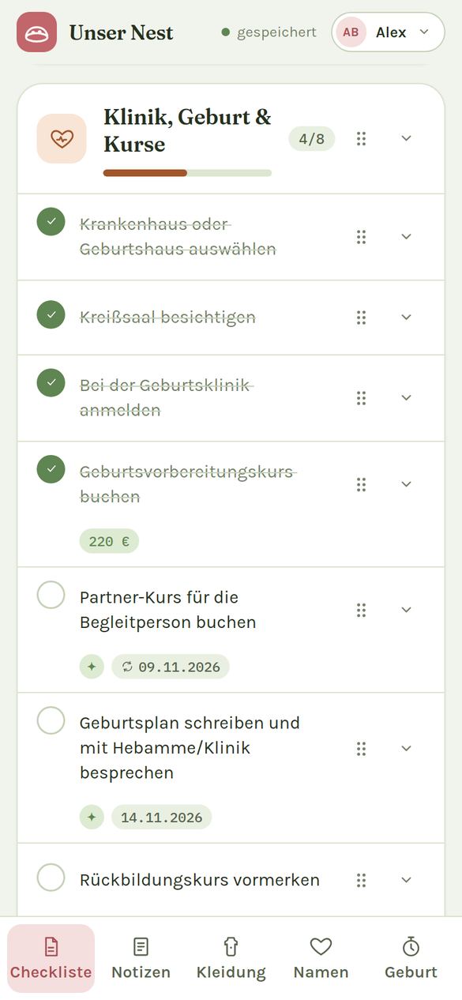<br><sub><b>Auf dem Handy</b> – Griff ⠿ und Aufklapp-Pfeil neben jedem Punkt, Kennzeichen darunter</sub></td>
    <td align="center" width="33%">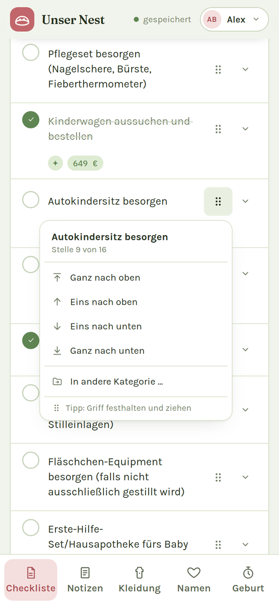<br><sub><b>Verschieben</b> – am Griff ziehen oder antippen: ganz nach oben/unten, eins nach oben/unten, in andere Kategorie</sub></td>
    <td align="center" width="33%">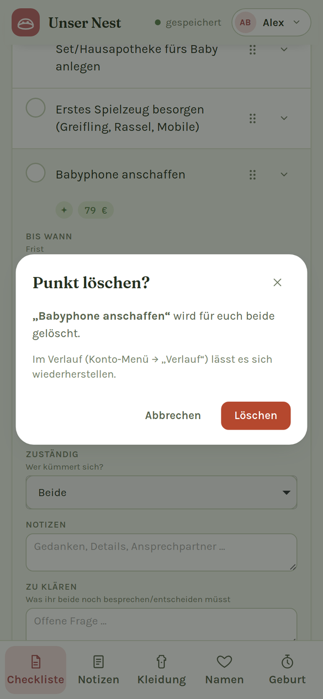<br><sub><b>Rückfrage vor dem Löschen</b> – „Abbrechen“ ist vorausgewählt</sub></td>
  </tr>
</table>

### Notizen

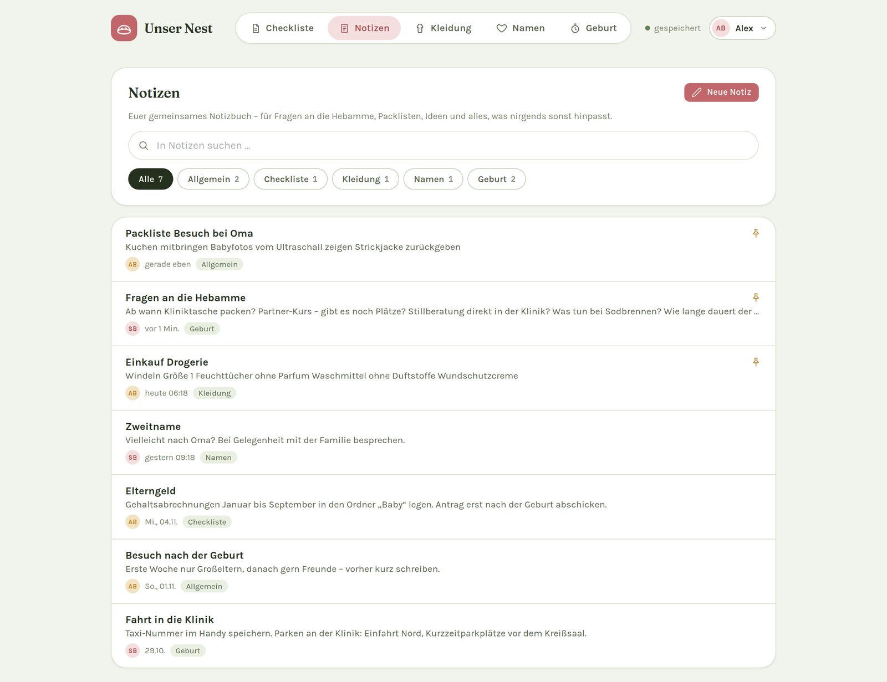

Das gemeinsame Notizbuch: Suche über Titel und Text, Filter nach Bereich,
angeheftete Notizen oben. Jede Zeile zeigt, wer zuletzt geändert hat und wann.

<table>
  <tr>
    <td align="center" width="50%">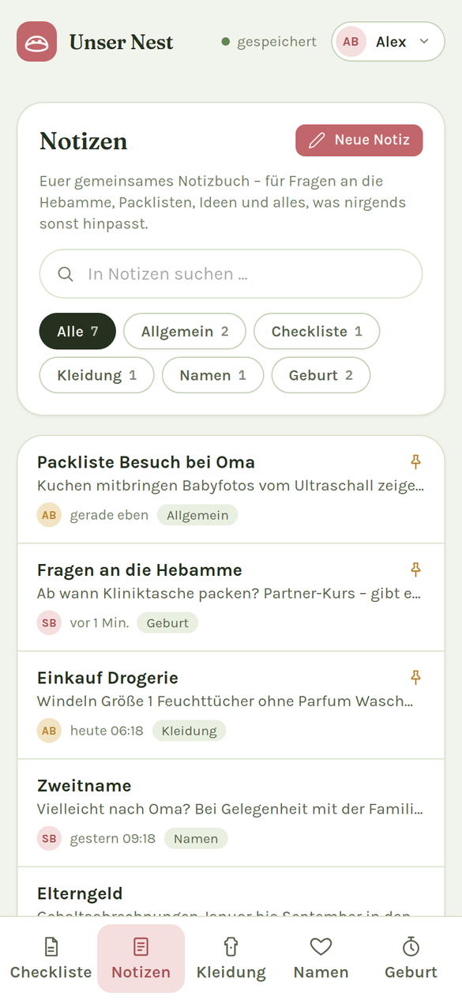<br><sub><b>Notizen</b> – eigener Bereich in der Leiste unten</sub></td>
    <td align="center" width="50%">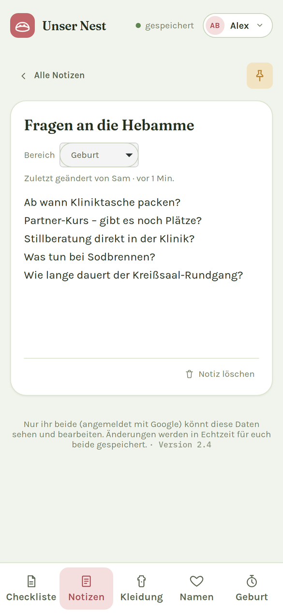<br><sub><b>Eine Notiz</b> – Titel, Text, Bereich und Anheften; gespeichert wird beim Tippen</sub></td>
  </tr>
</table>

### Baby-Kleidung, Namen und Geburt

<table>
  <tr>
    <td align="center" width="33%">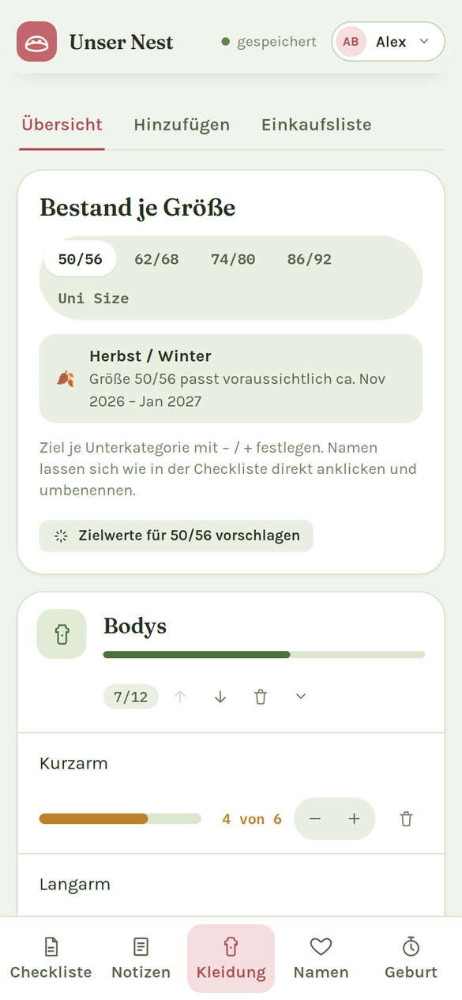<br><sub><b>Baby-Kleidung</b> – Bestand je Größe mit Zielwerten und der passenden Jahreszeit</sub></td>
    <td align="center" width="33%">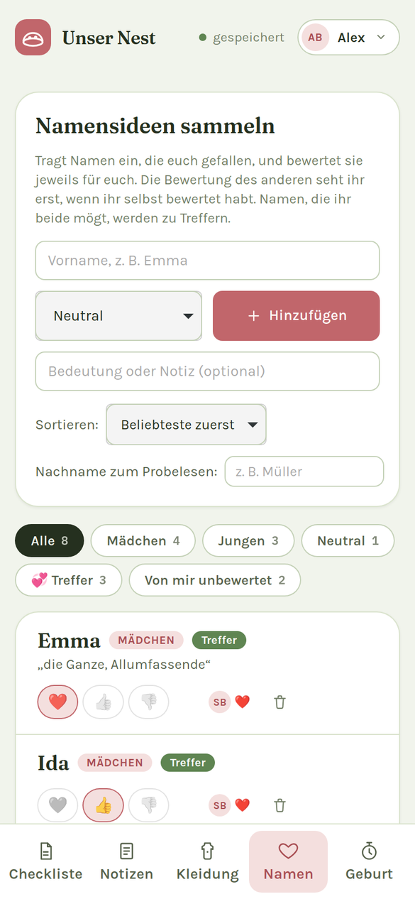<br><sub><b>Namen</b> – jede Person bewertet für sich; Treffer, wenn beide einen Namen mögen</sub></td>
    <td align="center" width="33%">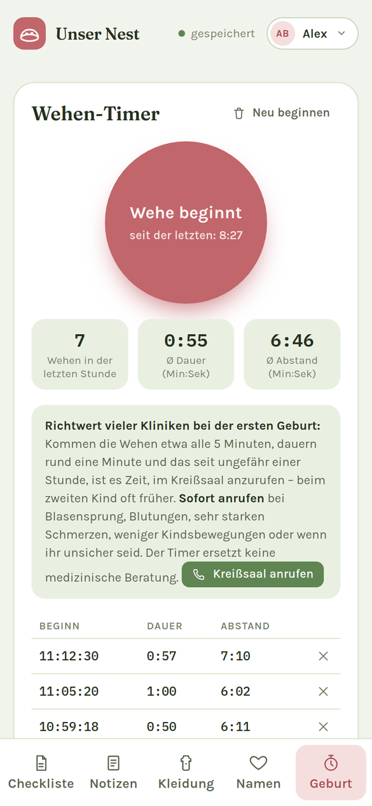<br><sub><b>Geburt</b> – Wehen-Timer mit Auswertung der letzten Stunde und wichtige Nummern</sub></td>
  </tr>
</table>

### Verlauf und dunkles Design

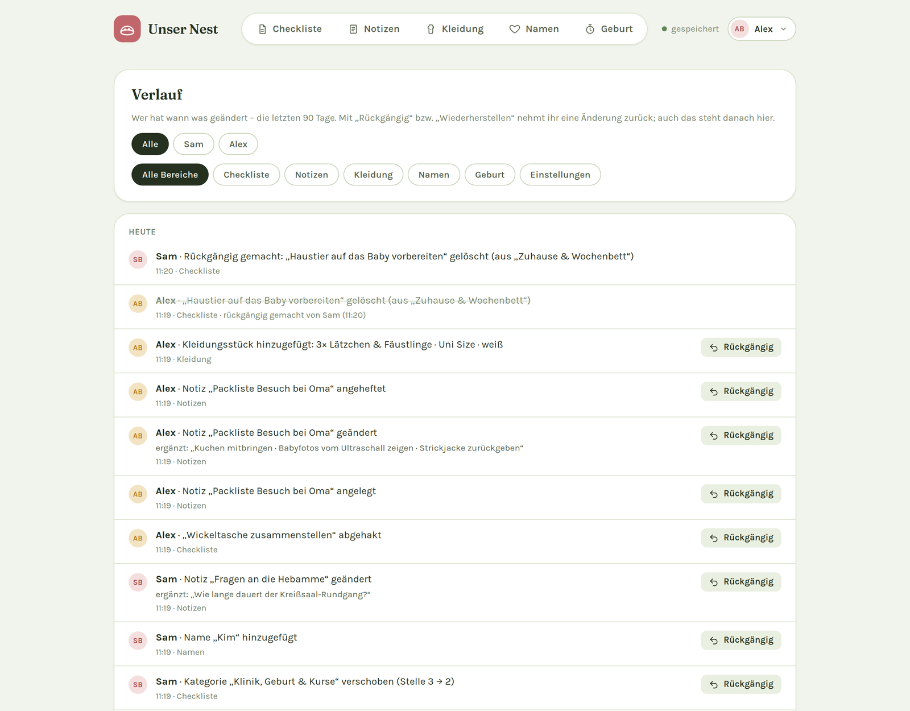

Der Verlauf zeigt jede Änderung mit Person, Uhrzeit und Bereich – jede lässt
sich zurücknehmen, gelöschte Einträge lassen sich wiederherstellen.

<p align="center">
  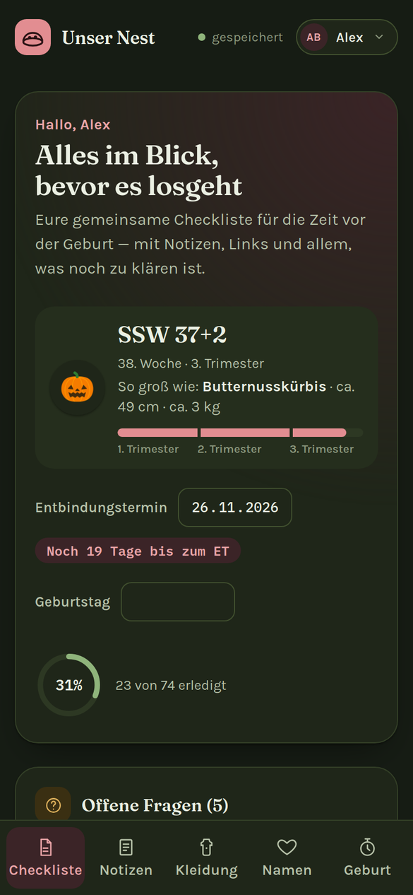
  <br><sub>Dunkles Design – automatisch nach Systemeinstellung oder fest wählbar</sub>
</p>

---

## Technischer Stack

- **Frontend:** Eine einzige HTML-Datei (HTML, CSS, JavaScript) – ohne Build-Schritt und ohne Framework
- **Datenbank:** [Cloud Firestore](https://firebase.google.com/docs/firestore) (Echtzeit-Sync, Offline-Speicher)
- **Anmeldung:** [Firebase Authentication](https://firebase.google.com/docs/auth) mit Google-Konto
- **Hosting:** [Firebase Hosting](https://firebase.google.com/docs/hosting)
- **Offline/Installation:** Service Worker + Web-App-Manifest (PWA)
- **Bibliotheken:** Firebase JS SDK 12 (Compat-Variante, per CDN) – sonst keine Abhängigkeiten
- **Tests:** Node.js-Testrunner (`node --test`)
- **Lokale Entwicklung:** [Firebase Emulator Suite](https://firebase.google.com/docs/emulator-suite)

---

## Projektstruktur

```
.
├── public/                        # Alles, was ausgeliefert wird
│   ├── index.html                 # Die komplette App (HTML, CSS, JavaScript)
│   ├── sw.js                      # Service Worker (Offline-Start)
│   ├── manifest.webmanifest       # Web-App-Manifest (Installation, Symbole)
│   └── icons/                     # App-Symbole
├── tests/
│   └── helpers.test.js            # Tests der reinen Hilfsfunktionen
├── docs/screenshots/              # Bilder für diese Dokumentation (Beispieldaten)
├── .devcontainer/
│   └── devcontainer.json          # Optionale Dev-Container-Konfiguration (VS Code/Codespaces)
├── firebase.json                  # Hosting (inkl. Header), Firestore, Emulator-Ports
├── firestore.rules.example        # Vorlage für die Zugriffsregeln (siehe unten)
├── firestore.indexes.json         # Firestore-Indizes (keine nötig)
├── .firebaserc.example            # Vorlage für die Projekt-Zuordnung (siehe unten)
├── package.json                   # npm-Skripte: test, start (Emulator)
├── CHANGELOG.md                   # Änderungsprotokoll
├── README.md                      # Diese Dokumentation
└── README.en.md                   # Englische Fassung
```

> Die Dateien `firestore.rules` (eure E-Mail-Adressen) und `.firebaserc`
> (eure Projekt-ID) legt ihr selbst aus den `*.example`-Vorlagen an – beide
> stehen in `.gitignore` und gehören **nicht** ins Repository. Innerhalb von
> `public/index.html` ist das Skript in kommentierte Abschnitte gegliedert
> (Konfiguration, reine Hilfsfunktionen, Vorlagen, Checkliste, Baby-Kleidung,
> Namen, Geburt, Sicherung, Anmeldung).

---

## Voraussetzungen

- Ein Google-Konto (für Firebase und die Anmeldung in der App)
- [Node.js](https://nodejs.org) 20 oder neuer
- Java 21 oder neuer (nur für den lokalen Emulator)
- Git

Kosten: Im kostenlosen **Spark-Tarif** normalerweise 0 €, keine Kreditkarte
nötig.

---

## Setup Schritt 1: Firebase-Projekt einrichten

1. Bei [console.firebase.google.com](https://console.firebase.google.com)
   einloggen und **Projekt hinzufügen** wählen. Google Analytics wird nicht
   gebraucht.
2. **Build → Authentication → Jetzt starten** → Tab **Sign-in method** →
   **Google** aktivieren.
3. Testnutzer eintragen, damit sich wirklich nur ihr anmelden könnt:
   [console.cloud.google.com/auth/audience](https://console.cloud.google.com/auth/audience)
   öffnen (in älteren Oberflächen „OAuth-Zustimmungsbildschirm“), Nutzertyp
   **Extern** und Status **Testing** belassen, unter **Testnutzer** die
   Google-Adressen aller Personen eintragen.
4. **Build → Firestore Database → Datenbank erstellen**, Standort z. B.
   `eur3 (europe-west)`. Der Startmodus spielt keine Rolle, weil in Schritt 4
   eigene Regeln hochgeladen werden.
5. Zahnrad → **Projekteinstellungen** → **Meine Apps** → **</>** (Web) →
   **App registrieren**. Den angezeigten Konfigurations-Code braucht ihr
   **nicht** zu kopieren: Firebase Hosting liefert ihn der App automatisch
   unter `/__/firebase/init.json` aus.
6. Die **Projekt-ID** notieren (Projekteinstellungen, z. B. `unser-nest-a1b2c`).
   Sie wird später in `.firebaserc` benötigt.

---

## Setup Schritt 2: Zugriffsregeln anlegen

Wer die App nutzen darf, steht ausschließlich in `firestore.rules`. Die Regeln
lassen nur angemeldete Google-Konten mit **verifizierter** Adresse aus der
Liste zu und erlauben den Zugriff auf `nest/shared` **und alles darunter** –
damit sind alle Bereiche der App (Checkliste, Notizen, Kleidung, Namen,
Kontakte, Wehen, Verlauf) abgedeckt. Alles andere in der Datenbank ist für niemanden zugänglich.

Der Zugriff ist damit doppelt abgesichert: Nur Testnutzer können sich
anmelden (Schritt 1), und die Datenbank prüft zusätzlich jede Anfrage gegen
diese Liste.

Die Vorlage wird in Schritt 3.3 nach `firestore.rules` kopiert und mit euren
Adressen gefüllt.

### Anhang: Firestore-Regeln

```
rules_version = '2';

// Vorlage – kopieren nach firestore.rules und die Adressen unten ersetzen:
//   cp firestore.rules.example firestore.rules
//
// Nur Google-Konten mit einer der unten eingetragenen E-Mail-Adressen dürfen
// die gemeinsamen Daten lesen oder schreiben. Alles andere wird abgelehnt
// (auch andere angemeldete Google-Konten, die die URL der App kennen).

service cloud.firestore {
  match /databases/{database}/documents {

    function isFamily() {
      return request.auth != null &&
        request.auth.token.email_verified == true &&
        request.auth.token.email in [
          "person-1@example.com",
          "person-2@example.com"
        ];
    }

    match /nest/{docId} {
      allow read, write: if isFamily();

      // Unterkollektionen (Kleidung, Namen, Kontakte, Wehen …) sind in
      // Firestore NICHT automatisch mit abgedeckt – dieser Block gibt der
      // Familie Zugriff auf alles darunter, in jeder Tiefe.
      match /{document=**} {
        allow read, write: if isFamily();
      }
    }

    // Alles andere in dieser Datenbank ist für niemanden zugänglich.
    match /{document=**} {
      allow read, write: if false;
    }
  }
}
```

---

## Setup Schritt 3: Lokale Entwicklungsumgebung

### 3.1 Repository klonen

```bash
git clone <URL-eures-Repositories>
cd <Repository-Ordner>
```

### 3.2 Firebase-CLI einrichten

```bash
npm install -g firebase-tools
firebase login
```

### 3.3 Regeln und Projekt konfigurieren

```bash
cp firestore.rules.example firestore.rules
cp .firebaserc.example .firebaserc
```

Anschließend `firestore.rules` öffnen und die Beispieladressen durch eure
Google-Adressen ersetzen (kleingeschrieben, dieselben wie bei den
Testnutzern). In `.firebaserc` den Platzhalter `euer-firebase-projekt` durch
eure Projekt-ID aus Schritt 1 ersetzen:

```json
{
  "projects": {
    "default": "unser-nest-a1b2c"
  }
}
```

> ⚠️ `firestore.rules` und `.firebaserc` **niemals** committen! Beide sind
> bereits in `.gitignore` eingetragen – ebenso Sicherungs-ZIPs und
> Kalenderdateien, die ihr aus der App herunterladet.

### 3.4 App lokal starten

```bash
npm start      # = firebase emulators:start --project demo-unser-nest
```

Die App ist danach unter `http://127.0.0.1:5000` erreichbar, die
Test-Datenbank unter `http://127.0.0.1:4000`. Zum Anmelden **Mit Google
anmelden** → **Add new account** → eine der Adressen aus `firestore.rules`
eingeben. Projekt-IDs, die mit `demo-` beginnen, erkennt die App und verbindet
sich automatisch mit den Emulatoren – euer echtes Projekt wird dabei nicht
angefasst.

Um das Zusammenspiel zweier Personen auszuprobieren: ein zweites
Browserfenster im privaten Modus öffnen und mit der zweiten Adresse anmelden.

### 3.5 Optional: Dev Container / GitHub Codespaces

Das Repository enthält eine `.devcontainer/devcontainer.json` für VS Code Dev
Containers bzw. GitHub Codespaces. Sie richtet Node.js, Java und die
Firebase-CLI ein und startet den Emulator automatisch.

> Die App erwartet den Emulator unter `127.0.0.1`. Das funktioniert, wenn der
> Container in VS Code geöffnet wird (lokal oder als Codespace in VS Code
> Desktop), weil VS Code die Ports auf den eigenen Rechner weiterleitet. In
> der reinen Browser-Ansicht von Codespaces erreicht die App den Emulator
> nicht.

---

## Setup Schritt 4: Deployment auf Firebase Hosting

1. Beim ersten Mal **Regeln und App** hochladen:
   ```bash
   firebase deploy
   ```
2. Am Ende steht die **Hosting URL**, z. B. `https://unser-nest-a1b2c.web.app` –
   euer privater Link. Beim allerersten Anmelden wird die Beispiel-Checkliste
   angelegt.
3. Später reicht für Änderungen an der App:
   ```bash
   firebase deploy --only hosting
   ```

> ⚠️ `--only hosting` lädt die Regeln **nicht** mit hoch. Nach Änderungen an
> `firestore.rules` einmal `firebase deploy --only firestore:rules` ausführen.

**Optional erst testen:** Eine zeitlich begrenzte Vorschau-Adresse mit den
echten Daten, während die gewohnte Adresse unverändert bleibt:

```bash
firebase hosting:channel:deploy vorschau --expires 7d
```

**Als App auf dem Handy:** Link öffnen, dann unter Android den Hinweis
„Installieren“ antippen, auf iPhone/iPad Teilen → „Zum Home-Bildschirm“.

**Zurück zur vorherigen Version:** Firebase Console → Hosting →
Versionsverlauf → „Rollback“. Die Daten bleiben dabei unverändert.

---

## Konfiguration

### Vorlagen und Listen anpassen

Checkliste, Kategorien der Baby-Kleidung, Namen und Kontakte werden direkt in
der App bearbeitet – nicht im Code. Im Code stehen nur Vorlagen und feste
Listen, jeweils am Anfang des Skripts in `public/index.html`:

| Was | Wo | Hinweis |
|---|---|---|
| Vorlage der Checkliste | `defaultState()` | gilt nur für neue Installationen |
| Vorlagen-Pakete | `TEMPLATE_PACKS` | jederzeit in der App nachladbar („Aus Vorlage hinzufügen“) |
| Kategorien der Baby-Kleidung | `DEFAULT_CLOTHING_CATEGORIES` | gilt, bis zum ersten Mal in der App bearbeitet wurde |
| Kleidergrößen | `CLOTHING_SIZES` | alte Größenangaben werden über `LEGACY_SIZE_MIGRATION` umgestellt |
| Alter je Größe | `SIZE_AGE_MONTHS` | Grundlage für die Jahreszeit je Größe |
| Zielwert-Vorschläge | `suggestTargets()` | je Größe und Jahreszeit (warm/mild/kalt) |
| Größenvergleich je SSW | `BABY_SIZE_BY_WEEK` | Name, Länge, Gewicht, Symbol |
| Farben | CSS-Variablen am Anfang von `<style>` | helles und dunkles Farbschema |

Nach Änderungen: `firebase deploy --only hosting`.

### Personen hinzufügen oder entfernen

Eine neue Person muss an **zwei** Stellen eingetragen werden: als Testnutzer
(Schritt 1, Punkt 3) und in `firestore.rules`. Danach die Regeln hochladen:

```bash
firebase deploy --only firestore:rules
```

### Anzeigenamen

Wie jemand in der App heißt, legt ihr direkt in der App fest: Konto-Menü (oben
rechts) → **„Anzeigenamen ändern …“**. Der Dialog zeigt ein Feld pro Person;
ein leeres Feld bedeutet „Vorname aus dem Google-Profil“. Der Name gilt auf
allen Geräten und wird in `nest/shared/meta/members` als `displayName`
gespeichert – das Google-Konto selbst bleibt unverändert, und eine erneute
Anmeldung überschreibt den Anzeigenamen nicht.

### Gleichzeitige Änderungen (Zusammenführen)

Checkliste und Kleidungs-Kategorien sind jeweils ein gemeinsames Dokument. Die
App merkt sich den letzten gemeinsamen Stand und führt beim Speichern (in
einer Firestore-Transaktion) und beim Empfangen zusammen: Pro Feld gewinnt,
wer es geändert hat; neue Punkte beider Seiten bleiben erhalten; Löschungen
und Verschiebungen werden übernommen. Nur wenn beide **dasselbe Feld**
gleichzeitig ändern, gewinnt die eigene Eingabe. Kleidungsstücke, Zielwerte,
Namen, Kontakte und Wehen sind einzelne Dokumente bzw. Felder und
überschneiden sich nie.

### Offline-Betrieb

Firestore speichert alle Daten zusätzlich im Browser, der Service Worker hält
die App selbst bereit. Ohne Netz startet die App aus dem Zwischenspeicher;
Änderungen werden später übertragen. Offline wird die Oberfläche nur
freigegeben, wenn genau dieses Konto auf diesem Gerät schon einmal vom Server
bestätigt wurde. „Abmelden“ im Konto-Menü löscht den Offline-Speicher wieder.

Bei jeder neuen Version (vor allem bei einer neuen Firebase-Version in
`index.html`) den Namen `CACHE` in `public/sw.js` hochzählen – dann werden
alte Dateien beim nächsten Start aufgeräumt.

### Umstieg von Version 1

Version 2 nutzt **dieselbe Datenbank** und liest alle Daten von Version 1
ohne Umwandlung; die Zugriffsregeln bleiben unverändert.

1. In Version 1 **„Sicherung herunterladen“** und die ZIP-Datei aufbewahren
   (Version 2 kann sie über das Konto-Menü wiederherstellen).
2. Den Code von Version 2 in den bisherigen Projektordner übernehmen –
   `firestore.rules` und `.firebaserc` bleiben, wie sie sind.
3. `firebase deploy --only hosting`.

Beide Versionen vertragen sich auch in der Übergangszeit: Speichert ein noch
offenes Fenster mit Version 1 die Checkliste, fehlen dort danach die Angaben,
die nur Version 2 kennt (Zuständig, erledigt von/am, Budget, Geburtstag).
Version 2 erkennt solche Stände am fehlenden Feld `schema` und ergänzt die
Angaben automatisch aus `nest/shared/meta/checklistExtras`.

### Schriftarten

Die Schriften werden von Google Fonts geladen. Wer das nicht möchte, kann sie
selbst hosten oder die `<link>`-Zeile im `<head>` von `index.html` entfernen
(dann greifen Systemschriften).

---

## Tests

```bash
npm test       # = node --test tests/*.test.js
```

Die Tests lesen den Abschnitt „REINE HILFSFUNKTIONEN“ direkt aus
`public/index.html` und prüfen ihn mit Node – ohne Browser, ohne Firebase und
ohne zusätzliche Pakete; es werden also keine Zugangsdaten benötigt. Die 36
Tests decken das Zusammenführen gleichzeitiger Änderungen, die Verträglichkeit
mit Version 1, das Verschieben von Punkten, den Verlauf (Änderungen erkennen
und zurücknehmen), die Notizen (Sortierung, Suche, Zeitangaben), Preiserkennung, Schwangerschaftswoche, Jahreszeit je Größe,
Zielwert-Vorschläge, Wehen-Auswertung, Kalender-Export, CSV-Schutz sowie
ZIP-Erzeugung und -Auslesen ab. Die Oberfläche selbst wird mit dem Emulator
(Schritt 3.4) ausprobiert.

---

## Datenbank-Schema-Referenz

| Pfad | Zweck | Wichtige Felder |
|---|---|---|
| `nest/shared` | Checkliste als **ein** Dokument | `dueDate`, `birthDate`, `budget`, `categories[]`, `schema`, `updatedAt` |
| `nest/shared/clothing/{id}` | Ein Dokument pro Kleidungsstück | `ober`, `unter`, `groesse`, `menge`, `farbe`, `muster`, `herkunft`, `von`, `gewaschen`, `photo` |
| `nest/shared/clothingMeta/targets` | Zielwerte der Baby-Kleidung | Schlüssel `kategorie\|unterkategorie\|größe` → Anzahl |
| `nest/shared/clothingMeta/categories` | Eigene Kategorien der Kleidung | `categories[]` mit `key`, `name`, `icon`, `subs[]` |
| `nest/shared/names/{id}` | Namensideen | `name`, `gender` (`w`/`m`/`n`), `note`, `votes` (je Person `2`/`1`/`-1`) |
| `nest/shared/contacts/{id}` | Wichtige Nummern | `label`, `name`, `phone`, `order` |
| `nest/shared/contractions/{id}` | Wehen | `start`, `end` (Millisekunden), `by` |
| `nest/shared/meta/members` | Angemeldete Personen (für „Zuständig“ usw.) | je Nutzer-ID: `email`, `name` (aus Google), `displayName` (selbst gewählt, optional) |
| `nest/shared/meta/checklistExtras` | Kopie der Angaben, die nur Version 2 kennt | `items{}` mit `wer`, `doneBy`, `doneAt`; `budget`, `birthDate` |
| `nest/shared/notes/{id}` | Notizen | `title`, `text`, `tag` (`allgemein`/`checklist`/`clothing`/`names`/`birth`), `pinned`, `createdBy`, `createdAt`, `updatedBy`, `updatedAt` (Millisekunden) |
| `nest/shared/history/{id}` | Verlauf (eine Änderung pro Dokument, 90 Tage) | `at`, `by`, `area`, `op`, `label`, `old`/`new` bzw. `data`, `undone` |

Die Punkte der Checkliste (`categories[].items[]`) haben die Felder `id`,
`title`, `done`, `bisWann` (Frist), `wann` (Termin), `wannRepeatWeekly`,
`preis` (Freitext), `notizen`, `zuKlaeren`, `links[]` (`label`, `url`), `wer`
(Nutzer-ID oder `"beide"`), `doneBy` und `doneAt`.

Fotos werden im Browser auf ca. 480 px verkleinert und als JPEG (typisch
20–60 KB) direkt im Dokument des Kleidungsstücks gespeichert, weil Cloud
Storage im kostenlosen Spark-Tarif nicht verfügbar ist. Da jedes Stück ein
eigenes Dokument ist, wird Firestores Grenze von 1 MB pro Dokument nie
erreicht.

---

## Troubleshooting

**„Dieses Konto hat keinen Zugriff“, obwohl die Adresse eingetragen ist**
Die Regeln sind vermutlich nicht hochgeladen – `firebase deploy --only
hosting` lädt sie **nicht** mit. Einmal `firebase deploy` ausführen und in der
Ausgabe auf „released rules firestore.rules“ achten. Außerdem Groß-/
Kleinschreibung der Adresse prüfen.

**„Firebase-Konfiguration nicht gefunden“**
Die App wurde nicht über Firebase Hosting geöffnet (z. B. `index.html` direkt
als Datei) oder es ist keine Web-App registriert (Schritt 1, Punkt 5).

**„Not in a Firebase app directory“**
Den Befehl im Projektordner ausführen – dort, wo `firebase.json` liegt.

**„No currently active project“ bzw. Deployment ins falsche Projekt**
`.firebaserc` aus der Vorlage anlegen (Schritt 3.3) oder das Projekt
ausdrücklich angeben: `firebase deploy --only hosting --project eure-projekt-id`.

**Anmelde-Fenster erscheint nicht**
Pop-up-Blocker für die Seite deaktivieren. Auf einer Vorschau-Adresse ggf.
die Domain unter Authentication → Einstellungen → Autorisierte Domains
eintragen.

**Die App zeigt eine alte Version**
Einmal neu laden (am Handy die App ganz schließen und wieder öffnen). Online
lädt die App immer zuerst die neueste Version; die Versionsnummer steht unten
auf der Seite.

**„offline – wird später übertragen“, obwohl Internet da ist**
Die Datenbank war kurz nicht erreichbar. Die Änderungen sind auf dem Gerät
gespeichert und werden automatisch übertragen.

**Darstellungsfehler auf iPhone/iPad (Safari)**
Safari berechnet manche Layouts anders als Chrome. Die aktuelle Version ist in
der Safari-Engine (WebKit) geprüft; bei neuen Auffälligkeiten hilft ein
Screenshot – und meist eine feste Breite statt nur `flex-basis`.

---

## Sicherheitshinweise

- Keine eigenen Server und kein Tracking: Alle Daten liegen im
  Firebase-Projekt der Person, die die App einrichtet.
- Der Zugriff wird **serverseitig** durch die Firestore-Regeln geprüft (nur
  verifizierte Adressen aus `firestore.rules`) und lässt sich im Browser nicht
  umgehen.
- Die Projekt-Konfiguration (API-Key, Projekt-ID) ist bei Firebase kein
  Geheimnis – Firebase Hosting liefert sie ohnehin öffentlich aus. Geschützt
  werden die Daten durch die Regeln, nicht durch das Verbergen der
  Konfiguration. Sie steht trotzdem bewusst nicht im Code.
- `firestore.rules`, `.firebaserc`, Sicherungs-ZIPs und Kalenderdateien
  niemals committen (alles in `.gitignore` eingetragen).
- Die Daten liegen zusätzlich im Browser des Geräts (Offline-Speicher).
  „Abmelden“ im Konto-Menü löscht diesen Speicher wieder – sinnvoll auf
  fremden Geräten.
- Eingaben werden vor der Anzeige maskiert, Links nur als `http(s)`
  ausgegeben, CSV-Exporte vor Formeln geschützt. In `firebase.json` sind
  zusätzliche Sicherheits-Header gesetzt.
- Der Wehen-Timer gibt eine gängige Faustregel wieder und ersetzt keine
  medizinische Beratung.
- Im OAuth-Modus „Testing“ erlaubt Google höchstens 100 Testnutzer – für eine
  Familie mehr als genug.

---

## Lizenz

Privates Projekt. Lizenz nach Bedarf ergänzen (z. B. MIT), falls das
Repository öffentlich geteilt werden soll.
